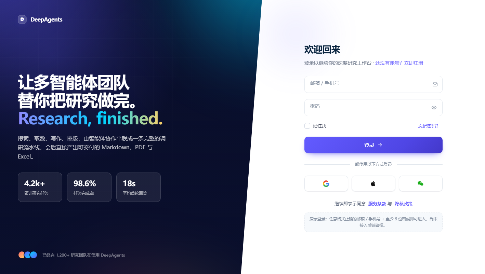
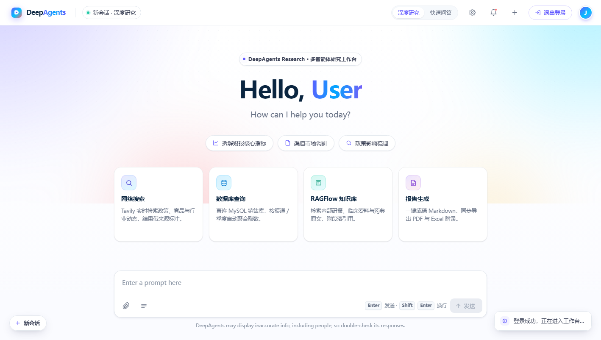
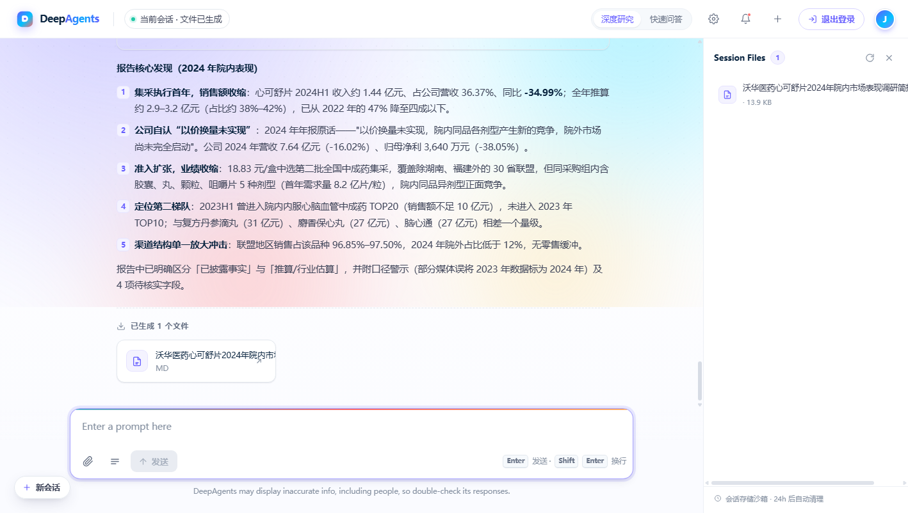

# DeepAgents · 多智能体企业调研平台

一个「多智能体协作做研究」的全栈 Demo：主智能体（团队负责人）根据你的问题自动调度 3 个子智能体
（**网络搜索** / **MySQL 数据库查询** / **RAGFlow 知识库检索**）分工干活，最终产出可下载的
**Markdown 报告 / PDF / Excel**，并在前端实时展示「思考过程、工具调用、生成文件」。

前后端分离：

- 后端：Python + FastAPI + DeepAgents（LangChain 生态），WebSocket 实时推送智能体事件
- 前端：Vue 3 + Vite（rolldown-vite）+ axios + marked，方案 05「Stripe 金融科技流体渐变风」，
  含**登录页**与研究工作台

## 界面预览

| 登录页 | 工作台（欢迎屏） | 研究结果 |
| --- | --- | --- |
|  |  |  |

## 功能特性

- **多智能体编排**：主智能体拆分任务 → 子智能体并行执行 → 汇总成文
- **流式过程可视化**：WebSocket 推送 `session_created / assistant_call / tool_start / task_result`，
  前端展示可折叠的「思考过程」与工具调用参数
- **真实文件产出**：生成的报告挂在 `output/session_<id>/` 下，右侧 Session Files 侧栏可预览/下载
- **登录页（演示鉴权）**：当前为纯前端格式校验（任意合法邮箱/手机号 + ≥6 位密码即可进入），
  支持「记住我」、第三方登录按钮占位，尚未接入后端真实鉴权
- **附件上传**：可上传 PDF / Word 等文件，由子智能体读取分析

## 目录结构

```
deep_agent_search/
├── main.py                  # 后端入口（默认 0.0.0.0:8000）
├── api/
│   ├── server.py            # FastAPI 应用：/api/task、/api/upload、/api/files、WS /ws/{thread_id}
│   ├── monitor.py           # WebSocket 连接管理 + 智能体事件推送
│   └── context.py           # 线程/会话上下文
├── agent/
│   ├── main_agent.py        # 主智能体（团队负责人）
│   ├── llm.py               # LLM 初始化（DeepSeek，OpenAI 兼容接口）
│   ├── load_prompts.py      # 读取 prompt/prompts.yml
│   └── sub_agents/          # 网络搜索 / 数据库 / RAGFlow 三个子智能体
├── tools/                   # 搜索、MySQL、RAGFlow、PDF、Markdown、文件读取等工具
├── prompt/prompts.yml       # 所有智能体的提示词
├── sql/                     # 数据库初始化脚本与数据
├── utils/                   # 日志、路径、格式转换工具
├── ui/                      # Vue 3 前端（源码在 ui/src/App.vue）
└── output/                  # 运行生成的会话文件（已被 gitignore）
```

## 快速开始

### 1. 准备环境变量

```powershell
# 在项目根目录执行：复制模板，然后填入你自己的密钥
copy .env.example .env
```

`.env` 里主要需要填（详见 `.env.example` 的注释）：

| 变量 | 说明 |
| --- | --- |
| `DEEPSEEK_BASE_URL` | DeepSeek 接口地址，如 `https://api.deepseek.com` |
| `DEEPSEEK_API_KEY` | DeepSeek API Key（也可只放系统环境变量） |
| `LLM_DEEPSEEK` | 模型名，如 `deepseek-flash` |
| `TAVILY_API_KEY` | Tavily 联网搜索的 Key |
| `MYSQL_*` | MySQL 连接信息（数据库查询子智能体使用） |
| `RAGFLOW_*` | RAGFlow 知识库地址与 Key（可选） |

> `.env` 已被 `.gitignore` 忽略，**不会**被提交到仓库；仓库里只保留没有密钥的 `.env.example`。

### 2. 启动后端（FastAPI）

```powershell
# 安装依赖（项目自带 uv.lock，推荐用 uv）
uv sync

# 启动后端：注意加 --port 8020
uv run uvicorn api.server:app --host 127.0.0.1 --port 8020
```

说明：

- 前端里把后端地址写死为 `http://127.0.0.1:8020`（见 `ui/src/App.vue` 顶部 `API_BASE` / `WS_BASE`），
  所以后端请监听 **8020**；
- `main.py` 直接运行时默认监听 `0.0.0.0:8000`，如果本机 8000 端口被别的服务占用，就用上面的 uvicorn 命令指定 8020。

### 3. 启动前端（Vue 3）

```powershell
cd ui
npm install
npm run dev -- --port 5180
```

然后用浏览器打开 **http://localhost:5180/**（注意必须用 `localhost`，不要用 `127.0.0.1:5180`：
当前 Vite 是 rolldown-vite，实测只监听 `[::1]:5180`）。

打开后先看到登录页，输入任意合法邮箱/手机号 + 至少 6 位密码即可进入工作台（演示鉴权，无需注册）。

## 使用流程

1. 登录 → 进入工作台欢迎屏
2. 输入研究问题（例如「帮我调研某某公司 2024 年的市场表现，输出 Markdown 报告」）
3. 观察「思考过程」中主智能体与子智能体的分工、工具调用
4. 在右侧 **Session Files** 查看生成的文件，点击即可预览/下载

## 说明

- 本项目是学习/演示性质的多智能体实践，登录鉴权为前端演示逻辑，尚未接入真实用户系统；
- 生成的报告/文件都在 `output/` 下（已被 gitignore），按会话目录隔离；
- 若数据库查询子智能体不可用，检查 MySQL 是否启动、`sql/db.sql` 是否已导入、`.env` 中 `MYSQL_*` 是否正确。
